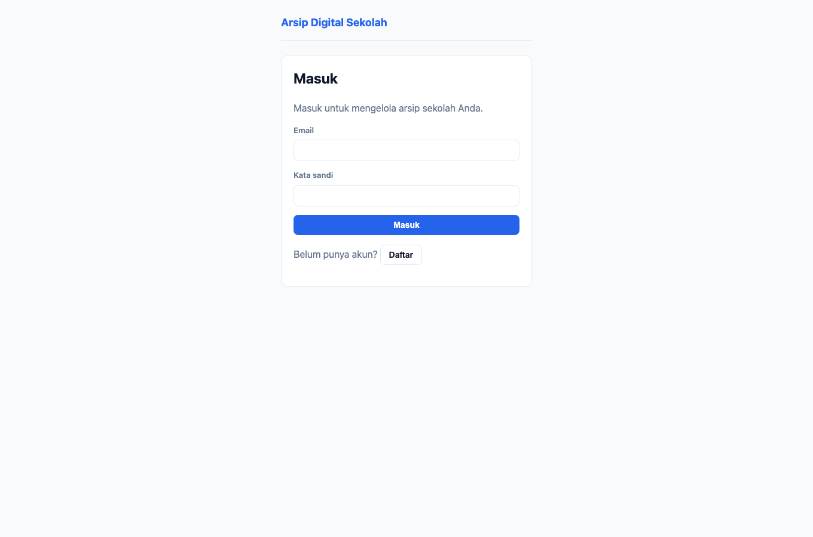

# Panduan Pengguna — Arsip Digital Sekolah

Panduan ini menjelaskan **cara memakai aplikasi untuk setiap jenis pengguna (peran)**
di Arsip Digital Sekolah. Setiap panduan memuat langkah-langkah beserta **tangkapan
layar asli** aplikasi.

Tangkapan layar dibuat otomatis dengan **Playwright** (`apps/e2e/tests/docs`) terhadap
data demo, sehingga selalu mencerminkan tampilan aplikasi yang sebenarnya. Lihat
[Cara membuat ulang tangkapan layar](#cara-membuat-ulang-tangkapan-layar).

## Peta panduan per peran

| Peran | Kode peran | Panduan | Ringkasan tugas utama |
|---|---|---|---|
| **Kepala Sekolah** | `headmaster` | [kepala-sekolah.md](kepala-sekolah.md) | Pemilik sekolah; akses penuh, keputusan akhir, tanda tangan ijazah |
| **Kepala Tata Usaha** | `head_of_administration` | [kepala-tu.md](kepala-tu.md) | Pengelola operasional: akademik, keuangan/BOS, integrasi & backup |
| **Operator** | `operator` | [operator.md](operator.md) | Entri data harian: dokumen, siswa, nilai, batch ijazah |
| **Guru** | `teacher` | [guru.md](guru.md) | Unggah materi/dokumen, cari arsip, input nilai & raport |
| **Auditor** | `auditor` | [auditor.md](auditor.md) | Pengawasan: skor kepatuhan, jejak audit, ekspor paket audit (baca-saja) |

> Peran ditentukan saat pengguna **diundang ke sekolah**. Satu akun dapat memiliki
> peran berbeda di sekolah berbeda (multi-tenant).

## Masuk ke aplikasi

Buka `http://localhost:3000` (atau alamat produksi). Tanpa sesi, Anda akan diarahkan
ke halaman masuk. Daftar akun baru, atau masuk dengan email & kata sandi.



1. Isi **Nama** (khusus pendaftaran), **Email**, dan **Kata sandi**.
2. Klik **Daftar** untuk membuat akun, atau **Masuk** bila sudah punya akun.
3. Setelah masuk, Anda diarahkan ke **Dasbor** yang menampilkan daftar sekolah Anda.
4. Klik salah satu **kartu sekolah** untuk membuka ruang kerja sekolah tersebut.

### Peran Anda tampil di dasbor

Setiap kartu sekolah menampilkan **peran** Anda pada sekolah itu (mis. `headmaster`,
`operator`). Menu di dalam sekolah menyesuaikan peran tersebut.

## Matriks hak akses (RBAC)

Tabel berikut merangkum kemampuan tiap peran. (✓ = boleh, — = tidak boleh.)

| Kemampuan | Kepala Sekolah | Kepala TU | Operator | Guru | Auditor |
|---|:---:|:---:|:---:|:---:|:---:|
| Dasbor & daftar sekolah | ✓ | ✓ | ✓ | ✓ | ✓ |
| Skor kepatuhan | ✓ | ✓ | ✓ | — | ✓ |
| Jejak audit | ✓ | ✓ | — | — | ✓ |
| Penyimpanan | ✓ | ✓ | ✓ | ✓ | ✓ |
| Tahun ajaran / semester / kelas (lihat) | ✓ | ✓ | ✓ | ✓ | ✓ |
| Tahun ajaran / semester / kelas (kelola) | ✓ | ✓ | ✓ | — | — |
| Aktifkan tahun ajaran | ✓ | ✓ | — | — | — |
| Struktur folder (generate) | ✓ | ✓ | — | — | — |
| Buat folder manual | ✓ | ✓ | ✓ | ✓ | — |
| Unggah dokumen | ✓ | ✓ | ✓ | ✓ | — |
| Daftar & cari dokumen | ✓ | ✓ | ✓ | ✓ | ✓ |
| Legal hold | ✓ | ✓ | — | — | ✓ |
| Aturan retensi (lihat) | ✓ | ✓ | ✓ | ✓ | ✓ |
| Aturan retensi (kelola) | ✓ | ✓ | — | — | — |
| E-Raport — kelola siswa/mapel/penugasan | ✓ | ✓ | ✓ | — | — |
| E-Raport — entri nilai & generate raport | ✓ | ✓ | ✓ | ✓ | — |
| E-Ijazah — buat batch & generate | ✓ | ✓ | ✓ | — | — |
| E-Ijazah — terbitkan / cabut | ✓ | ✓ | — | — | — |
| Keuangan/BOS — lihat | ✓ | ✓ | ✓ | ✓ | ✓ |
| Keuangan/BOS — catat arsip | ✓ | ✓ | ✓ | — | — |
| Keuangan/BOS — ekspor paket audit | ✓ | ✓ | — | — | ✓ |
| Pencarian full-text ber-facet | ✓ | ✓ | ✓ | ✓ | ✓ |
| Jalankan OCR tertunda | ✓ | ✓ | ✓ | — | — |
| Analitik sekolah | ✓ | ✓ | — | — | ✓ |
| Opt-in berbagi metrik | ✓ | ✓ | — | — | — |
| Integrasi & Pengaturan — lihat | ✓ | ✓ | — | — | ✓ |
| Integrasi & Pengaturan — kelola | ✓ | ✓ | — | — | — |
| Analitik jaringan (yayasan/dinas) | ✓ | — | — | — | ✓ |
| Verifikasi ijazah publik | Tanpa login | | | | |

> **Peran tidak dapat dinaikkan sendiri.** Hanya kepala sekolah yang dapat mengundang
> anggota. Antarmuka pengelolaan anggota masih berupa API
> (`POST /schools/{id}/members` lalu `POST /members/accept`); UI-nya menyusul.

## Menu di dalam sekolah

Setelah membuka sebuah sekolah, tersedia menu berikut (yang tidak berhak akan
menampilkan pesan atau tidak muncul):

| Menu | Rute | Untuk siapa |
|---|---|---|
| Beranda sekolah | `/schools/{id}` | Semua peran |
| E-Raport | `/schools/{id}/students` | Semua (kelola: kepala sekolah/TU/operator; nilai: + guru) |
| E-Ijazah | `/schools/{id}/eijazah` | Semua (terbitkan: kepala sekolah/TU) |
| Keuangan/BOS | `/schools/{id}/keuangan` | Semua (catat: kepala sekolah/TU/operator; ekspor: + auditor) |
| Analitik | `/schools/{id}/analitik` | Kepala sekolah, kepala TU, auditor |
| Pencarian | `/schools/{id}/pencarian` | Semua peran |
| Integrasi & Pengaturan | `/schools/{id}/pengaturan` | Kepala sekolah, kepala TU, auditor |
| Analitik Jaringan | `/analytics` | Kepala sekolah, auditor |

## Alur kerja umum (semua peran)

1. **Masuk** dan pilih sekolah dari dasbor.
2. Buka menu sesuai kebutuhan (lihat tabel di atas).
3. Untuk pekerjaan yang mengubah data, hasilnya tercatat otomatis di **jejak audit**
   sekolah (dilihat oleh kepala sekolah/TU/auditor).
4. Keluar dengan tombol **Keluar** di kanan atas.

## Cara membuat ulang tangkapan layar

Tangkapan layar dihasilkan oleh generator Playwright yang berdiri sendiri (tidak ikut
suite e2e default).

Prasyarat: PostgreSQL berjalan (migrasi + seed) dan dependensi terpasang.

```bash
# dari root repositori
npm run db:migrate
npm run db:seed
npm run install:browsers --workspace @arsip/e2e   # sekali saja

# hasilkan gambar ke docs/panduan-pengguna/gambar/
npm run docs:screenshots --workspace @arsip/e2e
```

Generator akan:

1. menyiapkan **sekolah demo** *SMA Negeri 1 Nusantara* beserta 5 akun peran dan
   data contoh (tahun ajaran, kelas, siswa, nilai, dokumen, ijazah, keuangan,
   integrasi) lewat API — idempoten, aman dijalankan berulang;
2. masuk sebagai tiap peran dan memotret halaman relevan;
3. **memverifikasi** bahwa halaman tidak menampilkan galat dan bahwa panel
   role-specific muncul/hilang sesuai hak akses.

Akun demo (kata sandi `Rahasia123!`):

| Peran | Email |
|---|---|
| Kepala Sekolah | `kepsek@nusantara-demo.sch.id` |
| Kepala TU | `ktu@nusantara-demo.sch.id` |
| Operator | `operator@nusantara-demo.sch.id` |
| Guru | `guru@nusantara-demo.sch.id` |
| Auditor | `auditor@nusantara-demo.sch.id` |

> Ingin sekolah demo terpisah? Setel `DOCS_SCHOOL_NAME` saat menjalankan generator.

Berkas terkait:

- `apps/e2e/tests/docs/panduan.spec.ts` — skenario tangkapan layar per peran.
- `apps/e2e/tests/docs/provision.ts` — penyiapan data demo.
- `apps/e2e/playwright.screenshots.config.ts` — konfigurasi khusus generator.
