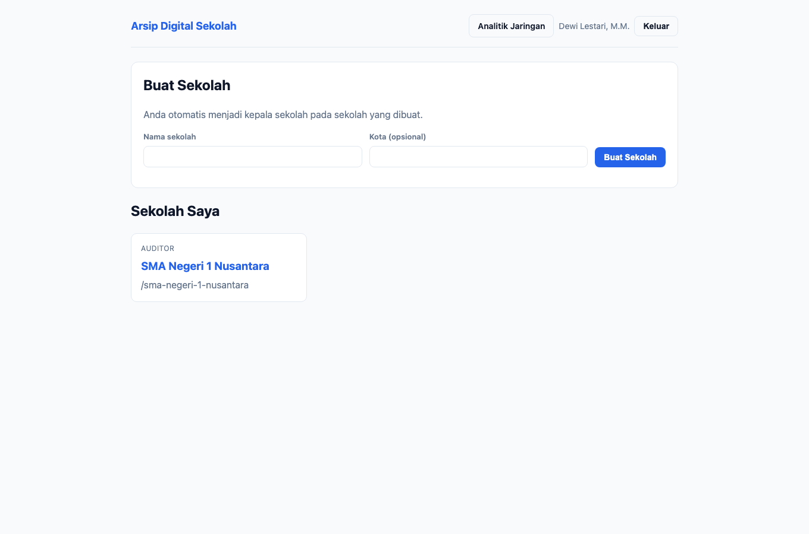
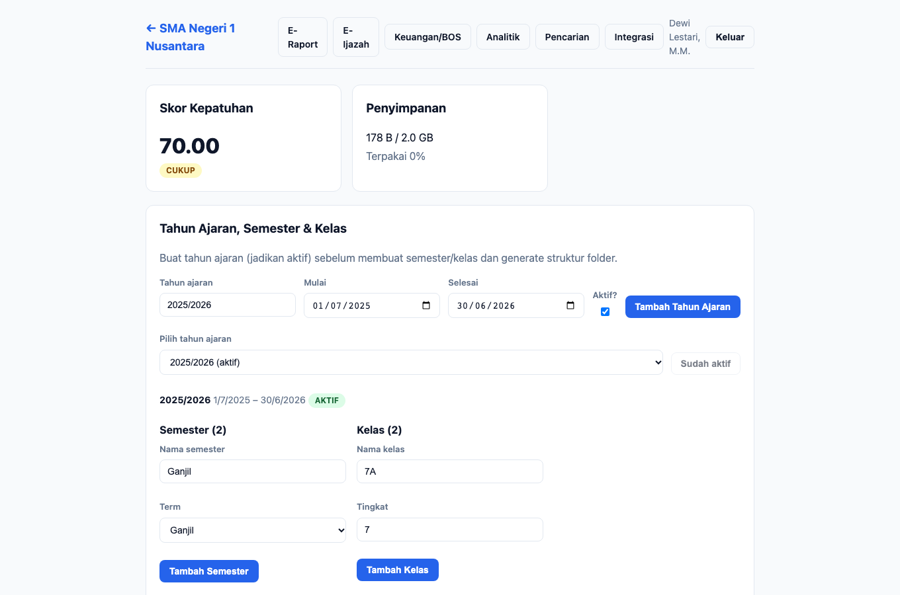
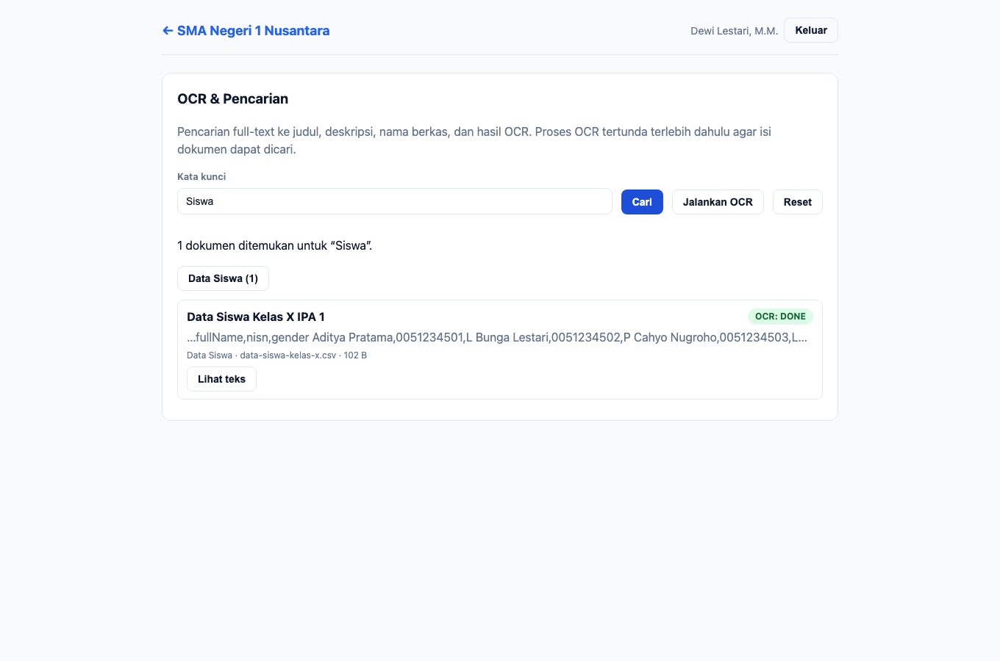
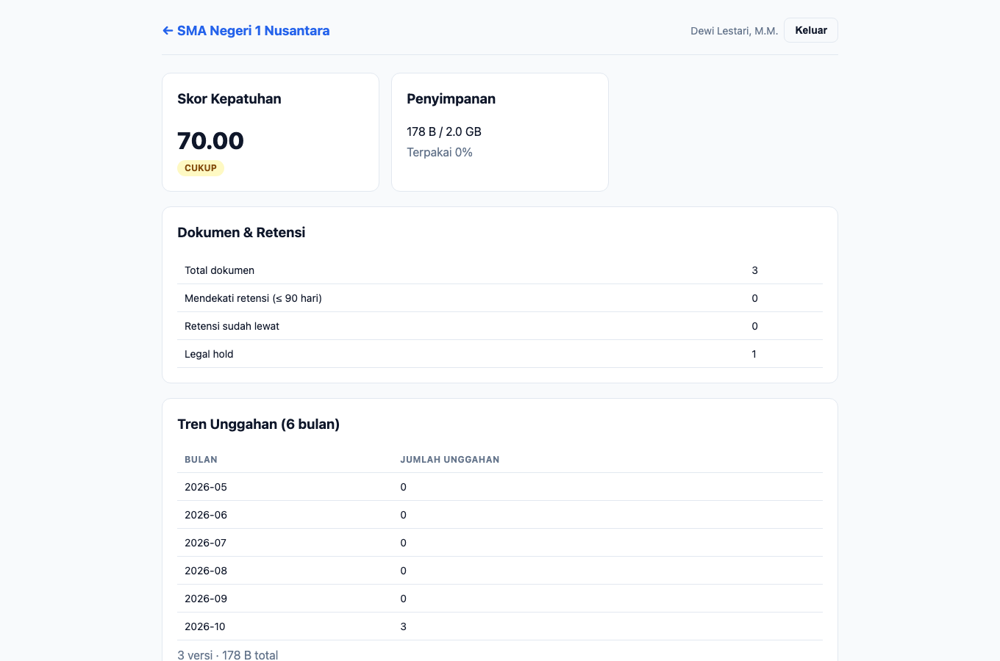
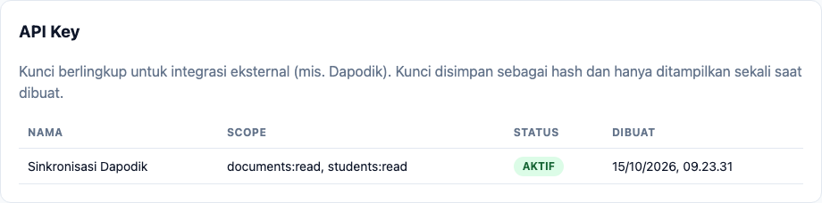
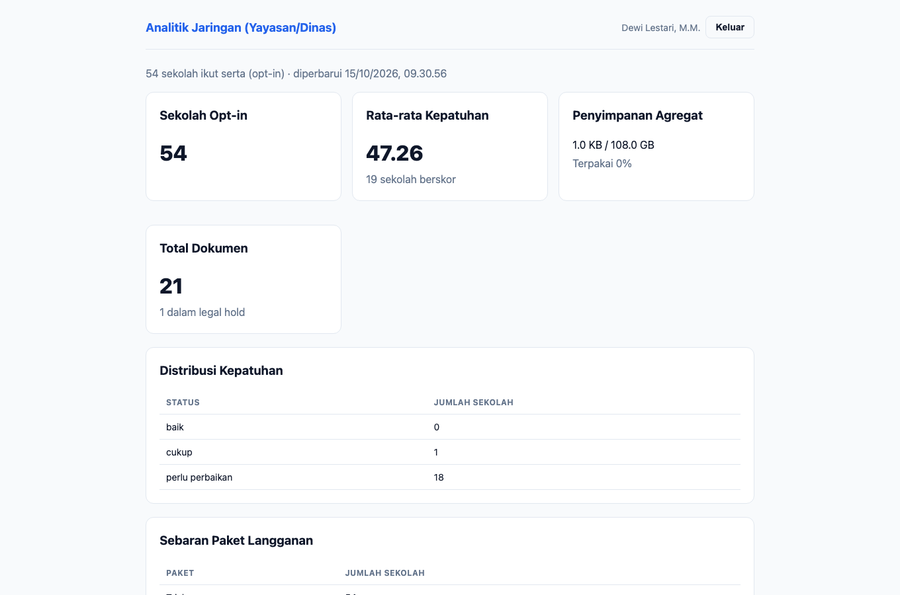

# Panduan — Auditor

**Peran:** `auditor`
**Inti tugas:** pengawasan (baca-saja). Memeriksa skor kepatuhan, jejak audit,
menelusuri arsip, mengekspor paket audit, dan membaca analitik. Auditor **tidak**
mengunggah atau mengubah data operasional, namun boleh menetapkan **legal hold**.

## 1. Dasbor

Auditor melihat daftar sekolah tempat ia menjadi anggota. Dasbor juga menampilkan
menu **Analitik Jaringan** (khusus kepala sekolah & auditor). Klik kartu sekolah
untuk memulai pemeriksaan.

## 2. Beranda sekolah

Beranda auditor menampilkan panel pengawasan: **Skor Kepatuhan**, **Penyimpanan**,
struktur akademik (lihat), struktur folder (lihat), daftar dokumen + legal hold,
versioning (lihat/unduh), **Jejak Audit**, dan aturan retensi. Form **Unggah Dokumen**
tidak diisi oleh auditor.

### 2.1 Skor kepatuhan

Ringkasan kesiapan audit. Skor **baik ≥ 80**, **cukup ≥ 60**, di bawahnya
**perlu perbaikan**. Bandingkan dengan riwayat pada halaman **Analitik**.

### 2.2 Jejak audit

Daftar aktivitas terbaru: **waktu, aksi, entitas, aktor**. Gunakan untuk menelusuri
riwayat perubahan (unggah, legal hold, penerbitan ijazah, ekspor, perubahan integrasi).

### 2.3 Legal hold

Auditor **dapat menetapkan/melepas legal hold** (dengan alasan wajib) untuk
mengamankan dokumen selama pemeriksaan. Dokumen yang ditahan tidak dapat dimusnahkan.

### 2.4 Versioning

Panel **Versioning** (pilih dokumen) untuk melihat riwayat versi, mengunduh, dan
membandingkan dua versi. Auditor **tidak** memulihkan versi (kewenangan pemilik
dokumen/admin).

## 3. Pencarian

1. Buka menu **Pencarian**.
2. Ketik kata kunci lalu **Cari**.
3. Telusuri hasil, gunakan **facet** (jenis/tahun/tag), dan **lihat teks** hasil
   ekstraksi OCR untuk menelusuri isi dokumen.

## 4. Analitik sekolah

Metrik per sekolah: skor kepatuhan + riwayat, storage, dokumen mendekati retensi
(≤ 90 hari), tren unggahan 6 bulan, dan dokumen per jenis. Auditor tidak mengubah
preferensi opt-in (kewenangan kepala sekolah/kepala TU).

## 5. Keuangan/BOS & ekspor paket audit

Menu **Keuangan/BOS**: auditor dapat **melihat** arsip & ringkasan serta
**mengekspor paket audit** (ZIP berisi `manifest.json`, `README.txt`, dan salinan
dokumen tertaut). Tindakan ekspor tercatat di jejak audit.

## 6. Integrasi & Pengaturan (baca-saja)

Auditor melihat konfigurasi integrasi (SSO, backup & riwayat job, API key, webhook,
agent on-prem) **tanpa tombol aksi**. Pengelolaan integrasi hanya untuk kepala
sekolah/kepala TU.

## 7. Analitik jaringan (yayasan/dinas)

Dasbor agregat **anonim** lintas sekolah opt-in: jumlah sekolah, rata-rata kepatuhan,
storage agregat, total dokumen, distribusi kepatuhan, sebaran paket, dan tren
unggahan. Tidak ada identitas sekolah yang ditampilkan.

## 8. Yang tidak dapat dilakukan auditor

- Mengunggah/mengubah dokumen, mengelola akademik, siswa, nilai, atau ijazah.
- Mencatat arsip keuangan, mengelola integrasi/backup, dan mengubah preferensi opt-in.
- Menjalankan OCR tertunda dan memulihkan versi dokumen.

---

## Catatan teknis (untuk pemelihara)

- Sumber skenario: `apps/e2e/tests/docs/panduan.spec.ts` (test *auditor*).
- Generator menegaskan auditor melihat `compliance-score` dan `audit-log-list`,
  serta `settings-no-access` **tidak** muncul (panel integrasi tampil baca-saja).
