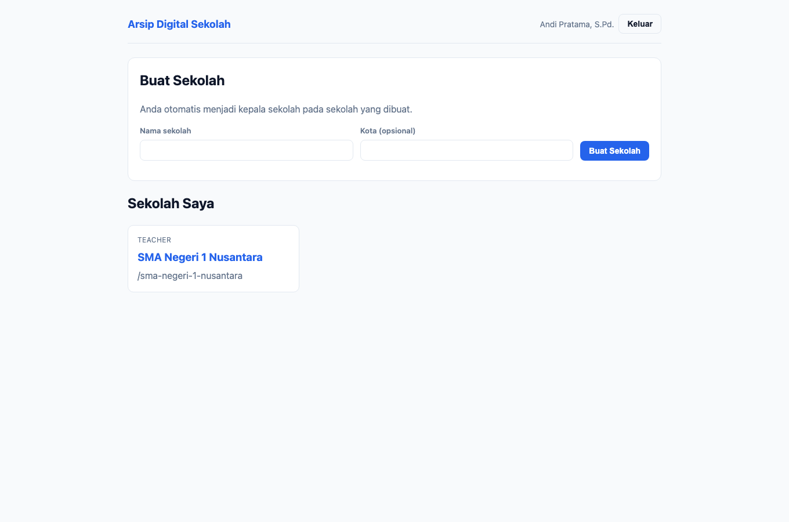
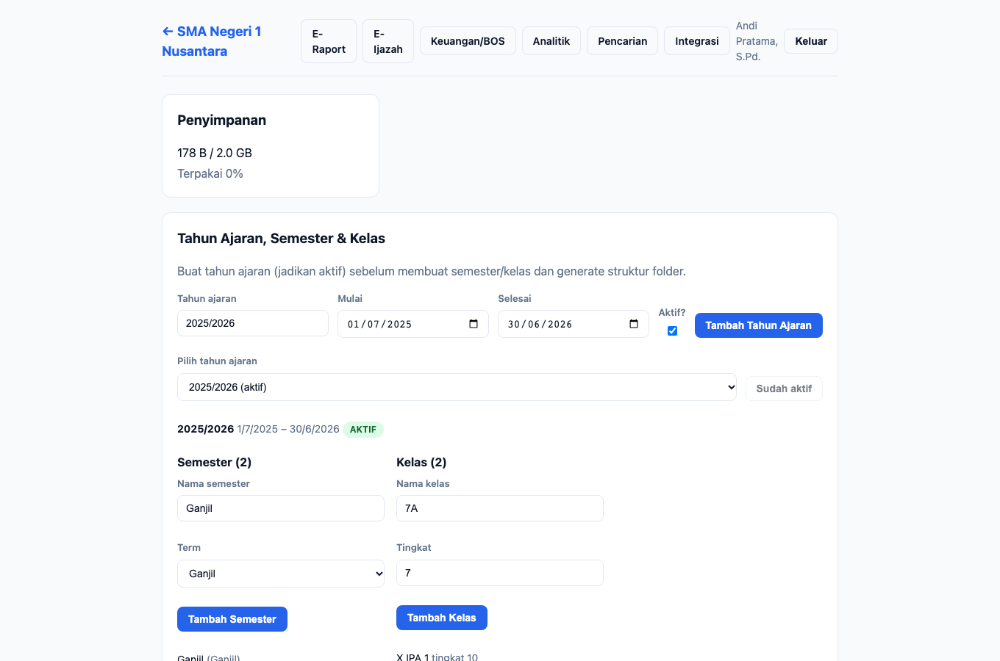
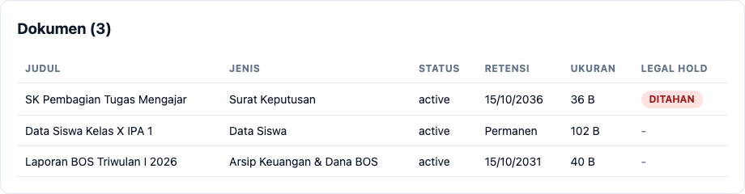
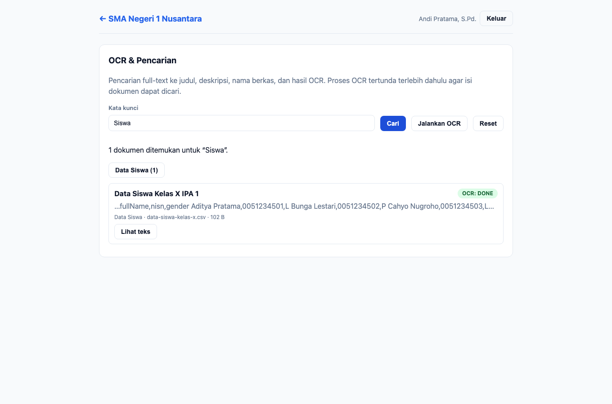
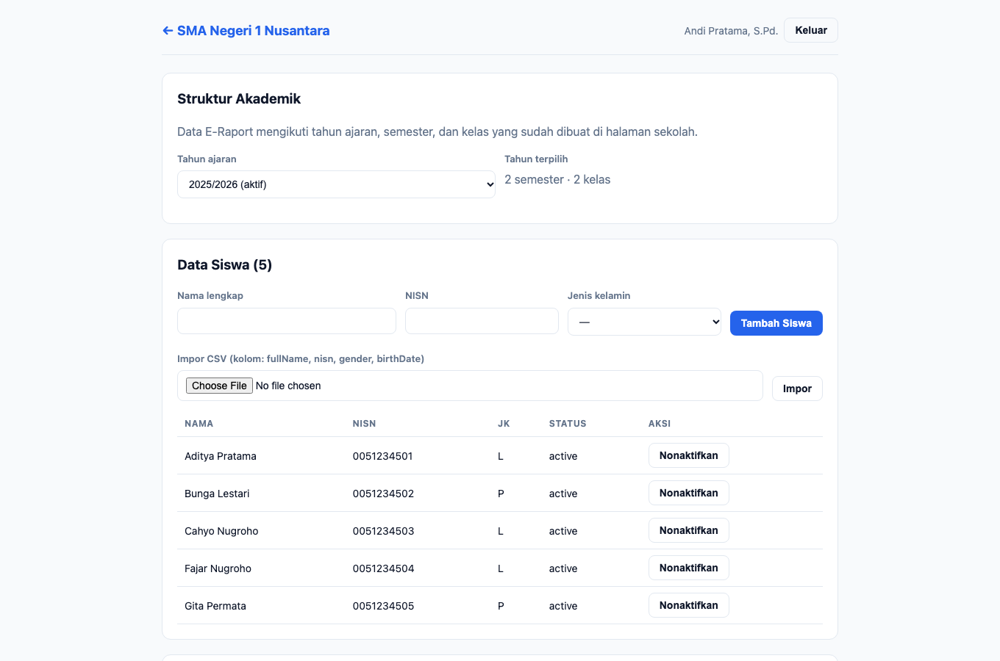
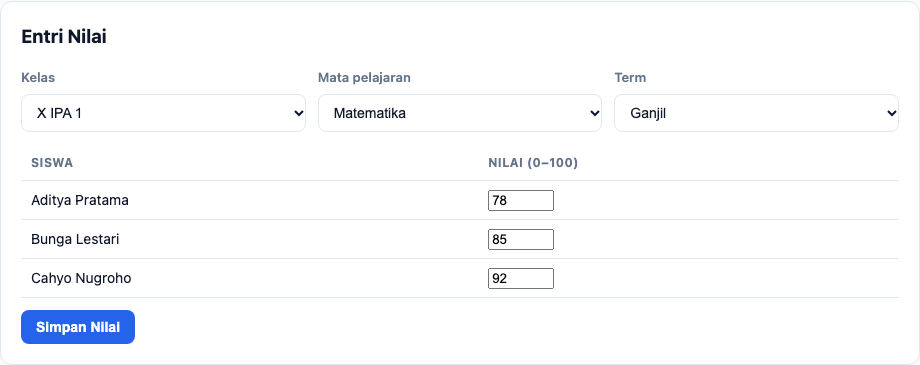

# Panduan — Guru

**Peran:** `teacher`
**Inti tugas:** mengunggah dokumen/materi, mencari arsip sekolah, serta menginput
nilai dan membuat raport untuk siswa.

## 1. Dasbor

Guru melihat daftar sekolah tempat ia menjadi anggota. Klik kartu sekolah untuk masuk.

## 2. Beranda sekolah

Guru melihat panel yang relevan: **Penyimpanan**, struktur akademik (lihat saja),
struktur folder (lihat), unggah dokumen, daftar dokumen, versioning, dan aturan
retensi. Panel **Skor Kepatuhan** dan **Jejak Audit** tidak ditampilkan karena bukan
kewenangan guru.

> **Catatan versi ini:** halaman sekolah kini tetap tampil utuh untuk guru. Sebelumnya
> permintaan skor kepatuhan/jejak audit yang tidak diizinkan membuat seluruh halaman
> gagal dimuat.

### 2.1 Unggah dokumen

1. Pilih **Jenis dokumen** (mis. *Raport*, *SK*, *Data Siswa*).
2. Isi **Judul** dan **Catatan perubahan** bila perlu.
3. Pilih **Berkas** lalu klik **Unggah**.

Guru dapat mengunggah dan membuat folder manual di dalam struktur yang tersedia.
**Generate struktur folder** serta **legal hold** hanya untuk kepala sekolah/kepala TU
(legal hold juga auditor).

### 2.2 Daftar dokumen

Lihat judul, jenis, status, retensi, ukuran, dan status legal hold. Kolom legal hold
tidak menampilkan tombol aksi bagi guru.

### 2.3 Versioning

Panel **Versioning** memungkinkan guru melihat riwayat versi, mengunduh, dan
membandingkan versi. **Memulihkan** versi hanya untuk pemilik dokumen atau admin
(kepala sekolah/TU/operator).

## 3. Pencarian & OCR

1. Buka menu **Pencarian**.
2. Ketik kata kunci (mis. `Siswa`) lalu klik **Cari**.
3. Hasil menampilkan judul, cuplikan teks, dan **facet** (jenis dokumen, tahun
   ajaran, tag) untuk mempersempit hasil.
4. Klik **Lihat teks** untuk membuka teks hasil ekstraksi OCR sebuah dokumen.

> Menjalankan **OCR tertunda** (memproses semua berkas) hanya untuk
> kepala sekolah/kepala TU/operator.

## 4. E-Raport

Menu **E-Raport** untuk mengelola akademik. Guru berfokus pada **entri nilai** dan
**generate raport**; pengelolaan data induk (siswa, mata pelajaran, penugasan kelas)
menjadi kewenangan kepala sekolah/TU/operator.

### 4.1 Entri nilai

1. Pilih **Kelas** dan **Mata Pelajaran** (serta term/semester).
2. Isi nilai pada kolom tiap siswa.
3. Klik **Simpan Nilai**. Input ulang bersifat *upsert* (tidak menghasilkan duplikat).
4. Di panel **Raport**, pilih kelas & semester lalu klik **Generate Raport** untuk
   membuat PDF, dan **Unduh** untuk mengunduhnya.

### 4.2 Yang tidak dapat dilakukan guru

- Menambah/mengubah/menghapus **siswa**, **mata pelajaran**, atau **penugasan kelas**.
- **Terbitkan/cabut ijazah**, catat **arsip keuangan**, kelola **integrasi/backup**,
  dan melihat **analitik**.
- Melihat **skor kepatuhan** dan **jejak audit** (kewenangan pengelola/auditor).

---

## Catatan teknis (untuk pemelihara)

- Sumber skenario: `apps/e2e/tests/docs/panduan.spec.ts` (test *guru*).
- Generator menegaskan guru **tidak** melihat `compliance-score` maupun
  `audit-log-list`, namun tetap melihat `upload-submit` dan tanpa `page-error`.
