# Panduan — Kepala Sekolah

**Peran:** `headmaster`
**Inti tugas:** pemilik sekolah. Memiliki **akses penuh** dan memegang keputusan akhir
(legal hold, pemusnahan terjadwal, penerbitan ijazah, integrasi & backup).

> Kepala sekolah selalu diizinkan pada setiap tindakan di sekolahnya, tanpa terkecuali.

## 1. Dasbor

Setelah masuk, dasbor menampilkan form **Buat Sekolah** dan daftar **Sekolah Saya**.
Saat Anda membuat sekolah, Anda otomatis menjadi **kepala sekolah** di sekolah itu.

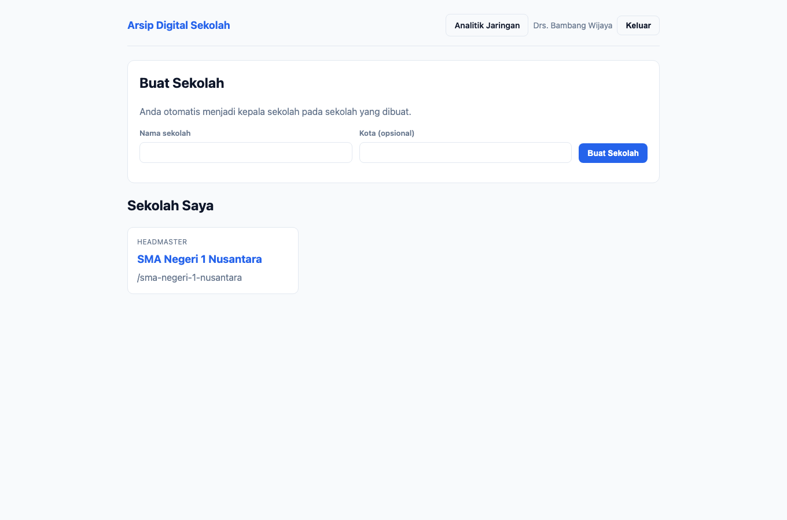

1. Isi **Nama sekolah** (wajib) dan **Kota** (opsional), lalu klik **Buat Sekolah**.
2. Klik kartu sekolah untuk masuk ke ruang kerja sekolah.

## 2. Beranda sekolah

Beranda adalah pusat kendali arsip. Kepala sekolah melihat **semua** panel:

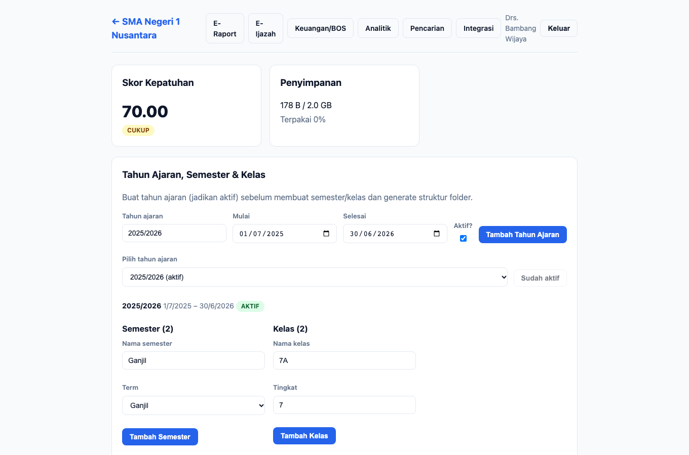

- **Skor Kepatuhan** — nilai kepatuhan arsip sekolah (baik ≥ 80, cukup ≥ 60).
- **Penyimpanan** — pemakaian kuota.
- **Tahun Ajaran, Semester & Kelas** — kelola struktur akademik.
- **Struktur Folder** — struktur arsip otomatis.
- **Unggah Dokumen**, daftar dokumen, **Versioning**, **Jejak Audit**, dan
  **Aturan Retensi Otomatis**.

### 2.1 Skor kepatuhan

Skor dihitung dari kelengkapan arsip (mis. kelengkapan jenis dokumen wajib, retensi,
legal hold). Gunakan sebagai ringkasan kesiapan audit.

### 2.2 Kelola struktur akademik

Panel **Tahun Ajaran, Semester & Kelas** untuk membuat/mengaktifkan tahun ajaran,
semester, dan kelas. Aktifkan tepat **satu** tahun ajaran pada satu waktu.

1. Buat tahun ajaran (mis. `2025/2026`) lalu klik **Aktifkan**.
2. Tambahkan **Semester** (Ganjil/Genap).
3. Tambahkan **Kelas** beserta tingkatnya.

### 2.3 Struktur folder

Klik **Generate Struktur Folder** untuk membuat struktur
`Arsip → Tahun Ajaran → Semester → Kelas → Jenis Dokumen` secara otomatis.
Jalankan ulang kapan pun — folder yang sudah ada tidak diduplikasi.

### 2.4 Unggah dokumen

1. Pilih **Jenis dokumen** (menentukan kebijakan retensi & ekstensi yang diizinkan).
2. Isi **Judul** dan **Catatan perubahan** (opsional).
3. Pilih **Berkas** (PDF/DOCX/XLSX/CSV/JPG/PNG sesuai jenis), lalu klik **Unggah**.
4. Jika berkas identik sudah ada, sistem melakukan **deduplikasi**; jika judul sama,
   sistem membuat **versi baru** secara otomatis.

### 2.5 Daftar dokumen & legal hold

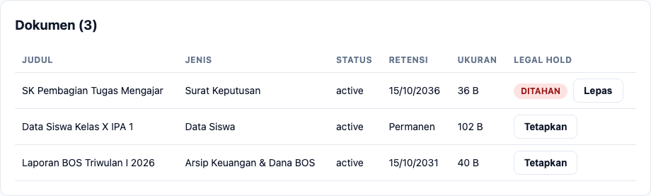

Tabel menampilkan judul, jenis, status, tanggal kedaluwarsa retensi, ukuran, dan
status **legal hold**.

- Klik **Tetapkan** pada kolom Legal Hold untuk menahan dokumen (alasan **wajib**).
  Dokumen yang ditahan **tidak dapat dimusnahkan**.
- Klik **Lepas** untuk membatalkan penahanan.

### 2.6 Versioning

Panel **Versioning** (pilih dokumen) menampilkan riwayat versi:

1. **Unduh** versi mana pun.
2. **Bandingkan** dua versi (perubahan konten & metadata).
3. **Pulihkan** versi lama menjadi versi baru (aditif, versi lama tetap tersimpan).

### 2.7 Jejak audit

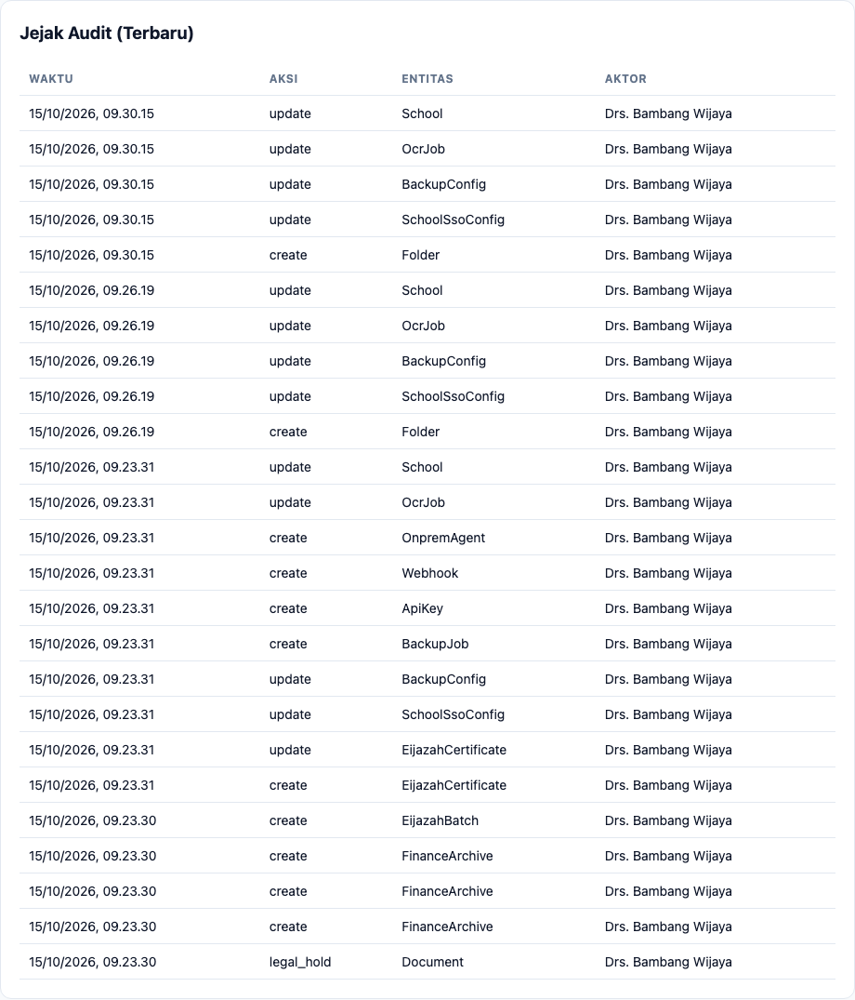

Seluruh perubahan penting (unggah, legal hold, penerbitan ijazah, ekspor, perubahan
integrasi) tercatat otomatis: waktu, aksi, entitas, dan aktor.

### 2.8 Aturan retensi otomatis

Beranda menampilkan daftar aturan retensi per jenis dokumen. Pengelolaan aturan
(tambah/ubah/hapus) dilakukan oleh kepala sekolah/kepala TU melalui API; otomasi
pengantrian pemusnahan dapat dinyalakan per sekolah.

## 3. E-Raport

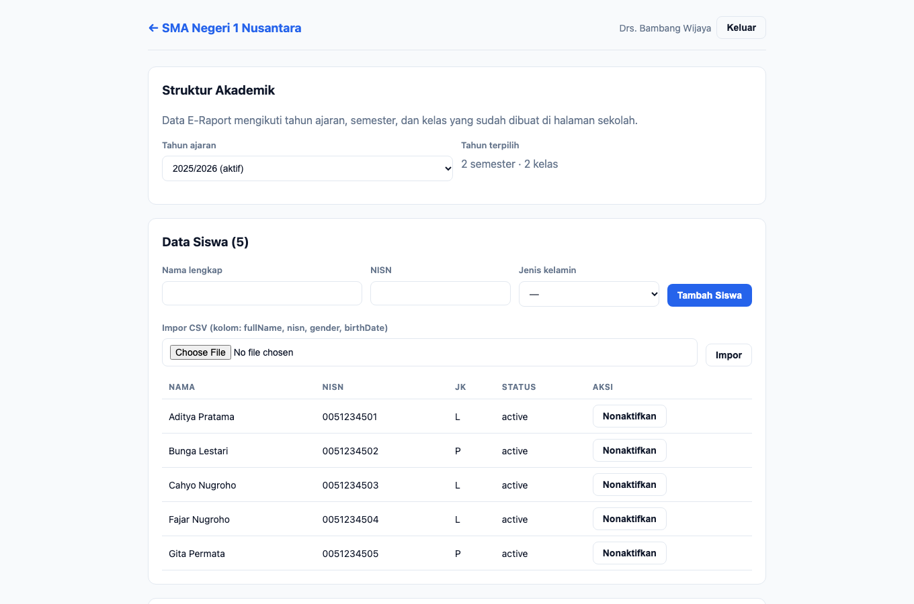

Menu **E-Raport** memuat seluruh alur akademik: data siswa (CRUD + impor CSV), mata
pelajaran, penugasan siswa ke kelas, entri nilai, dan generate raport PDF. Kepala
sekolah dapat melakukan semua langkah. Lihat detail langkah pada
[Panduan Operator → E-Raport](operator.md#3-e-raport).

## 4. E-Ijazah

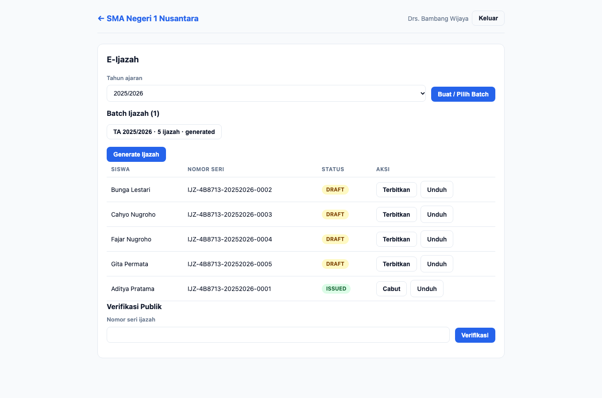

Hanya kepala sekolah & kepala TU yang boleh **menerbitkan/mencabut** ijazah.

1. Pilih **Tahun Ajaran**, lalu **Buat Batch**.
2. Klik **Generate** untuk membuat sertifikat (status `draft`) bagi siswa terdaftar.
3. Klik **Terbitkan** untuk memberi tanda tangan elektronik (HMAC-SHA256) — status
   menjadi `issued`. Ijazah terbit memiliki nomor seri `IJZ-...` dan dapat
   diverifikasi publik.
4. Klik **Cabut** untuk membatalkan ijazah yang salah terbit.
5. **Unduh PDF** ijazah ber-QR kapan pun.

## 5. Keuangan/BOS

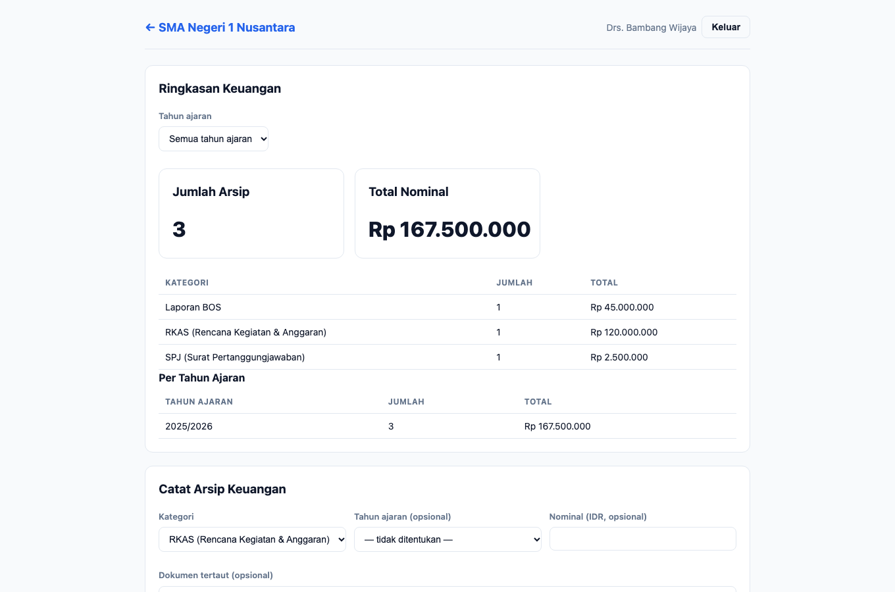

Lihat, catat, dan **ekspor paket audit** arsip keuangan. Lihat
[Panduan Kepala TU → Keuangan](kepala-tu.md#3-keuanganbos) untuk langkah lengkap.

## 6. Analitik sekolah

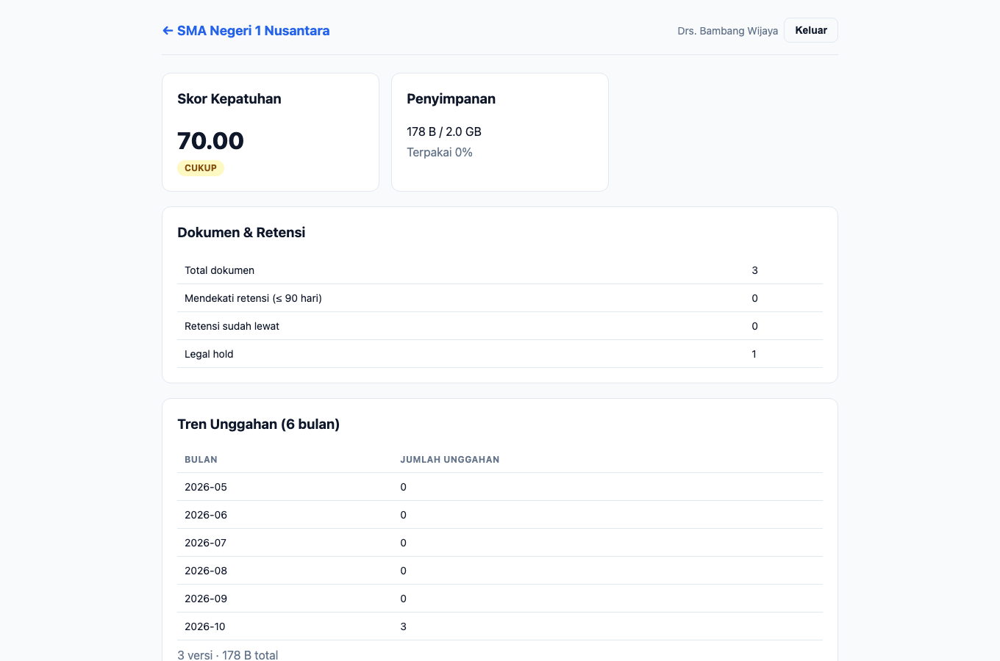

Menampilkan skor kepatuhan + riwayat, pemakaian storage, dokumen mendekati retensi
(≤ 90 hari), tren unggahan 6 bulan, dan dokumen per jenis.

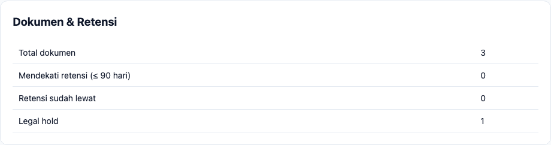

Di bagian **Berbagi Metrik Lintas Sekolah**, kepala sekolah/kepala TU dapat
menyalakan **opt-in** untuk ikut menyumbang metrik anonim ke dasbor jaringan.

## 7. Integrasi & Pengaturan

Menu **Integrasi & Pengaturan** mengatur SSO, backup, API key, webhook, dan agent
on-prem.

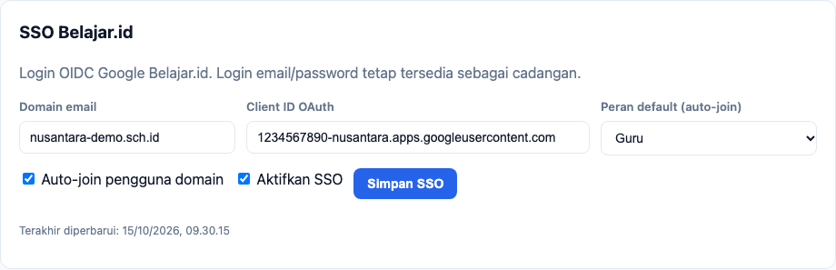

1. **SSO Belajar.id** — isi domain, client id OIDC, pilih auto-join & peran default,
   lalu **Simpan**.

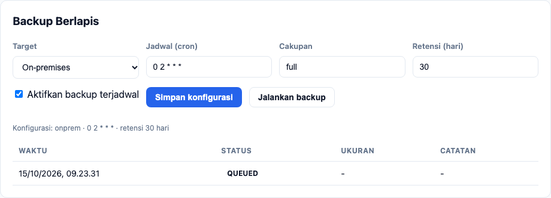

2. **Backup Berlapis** — pilih target (cloud/on-prem), jadwal (cron), cakupan, dan
   retensi; **Simpan** lalu **Jalankan** untuk membuat job. Riwayat job tampil di
   bawah panel.
3. **API Key** — buat kunci berlingkup; kunci mentah (`ak_...`) **hanya tampil sekali**.
4. **Webhook** — daftarkan URL & event; `secret` untuk verifikasi tanda tangan hanya
   tampil sekali.
5. **Agent On-Prem** — daftarkan agen serta token-nya (sekali tampil) untuk backup
   mandiri di server sekolah.

## 8. Analitik jaringan (yayasan/dinas)

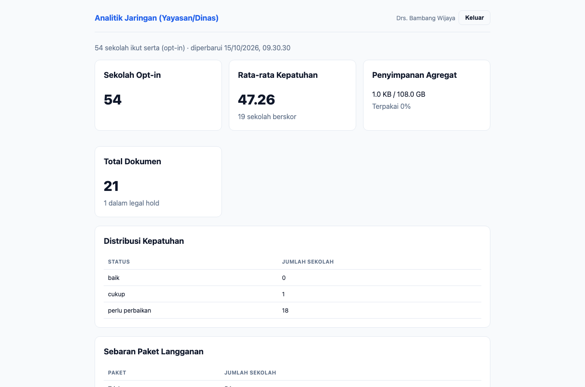

Dasbor agregat **anonim** lintas sekolah yang ikut opt-in: jumlah sekolah, rata-rata
kepatuhan, storage agregat, total dokumen, distribusi kepatuhan, sebaran paket, dan
tren unggahan. Hanya kepala sekolah & auditor yang dapat mengakses.

---

## Catatan teknis (untuk pemelihara)

- Sumber skenario: `apps/e2e/tests/docs/panduan.spec.ts` (test *kepala sekolah*).
- Penanda uji utama: `school-page`, `compliance-score`, `audit-log-list`,
  `upload-doc-type`, `document-list`, `sso-domain`, `backup-submit`.
- Generator memastikan halaman tidak menampilkan `page-error` dan panel
  role-specific sesuai hak akses.
