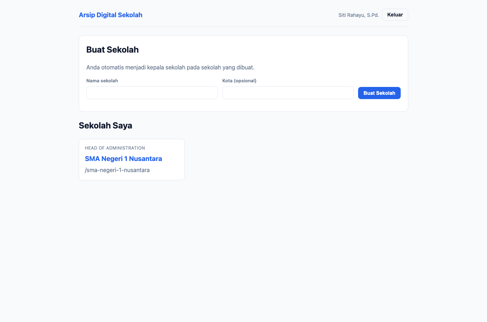
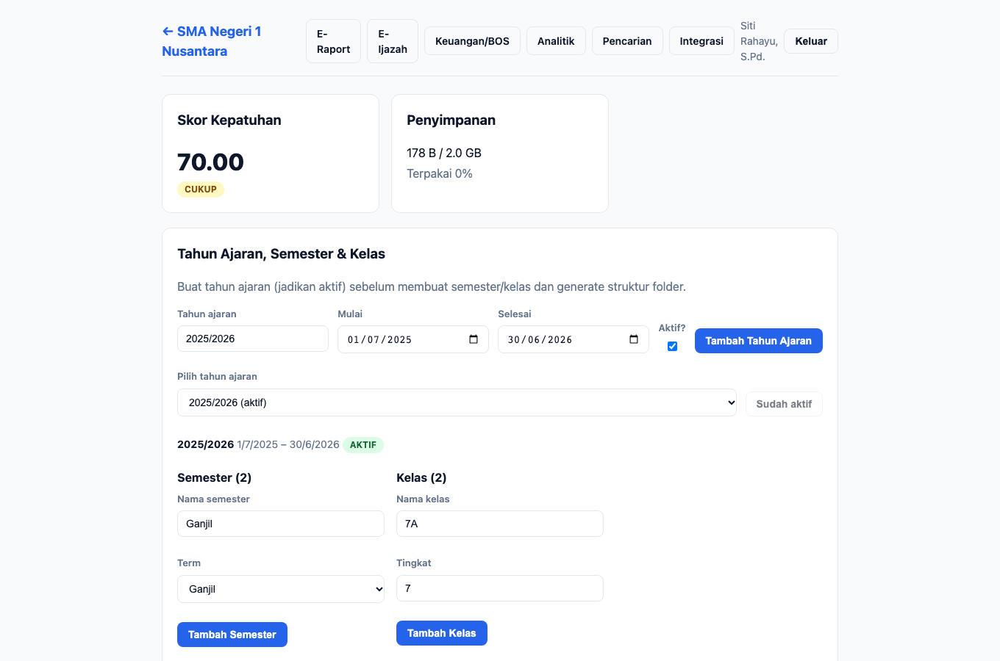
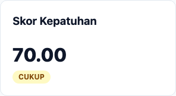
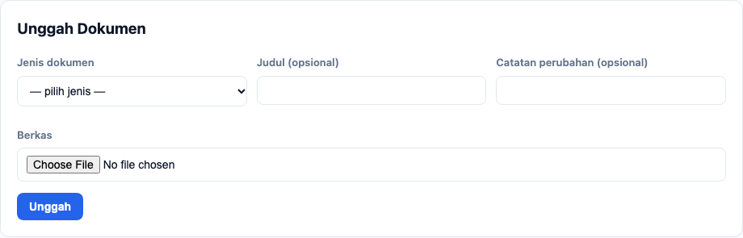
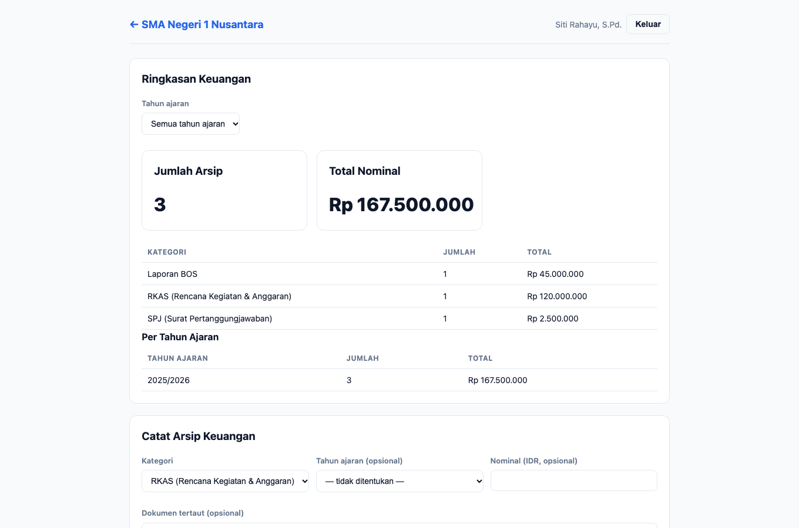

# Panduan — Kepala Tata Usaha

**Peran:** `head_of_administration`
**Inti tugas:** pengelola operasional sekolah. Mengelola akademik, keuangan/BOS,
integrasi & backup, serta retensi — hampir setara kepala sekolah, kecuali keputusan
yang sangat berwenang (mis. penomoran & keputusan akhir tertentu tetap dapat
dilakukan bersama kepala sekolah).

## 1. Dasbor

Kepala TU melihat daftar sekolah tempat ia menjadi anggota. Klik kartu sekolah untuk
masuk ke ruang kerja.

> Membuat sekolah baru menjadikan Anda **kepala sekolah** pada sekolah tersebut.
> Untuk berperan sebagai kepala TU, minta kepala sekolah mengundang Anda dengan
> peran `head_of_administration`.

## 2. Beranda sekolah

Kepala TU memiliki akses ke seluruh panel beranda: **Skor Kepatuhan**,
**Penyimpanan**, struktur akademik, struktur folder, unggah dokumen, daftar dokumen
+ legal hold, versioning, jejak audit, dan aturan retensi.

### 2.1 Skor kepatuhan

Gunakan untuk memantau kelengkapan arsip dan kesiapan audit.

### 2.2 Unggah dokumen

1. Pilih **Jenis dokumen**, isi **Judul**/catatan perubahan (opsional).
2. Pilih **Berkas** lalu klik **Unggah**. Berkas identik otomatis dideduplikasi.

### 2.3 Yang dapat Anda kelola

- **Struktur akademik** (tahun ajaran/semester/kelas) — buat & aktifkan tahun ajaran.
- **Generate struktur folder** otomatis.
- **Legal hold** dokumen (tetapkan/lepas, dengan alasan wajib).
- **Versioning** — unduh, bandingkan, pulihkan versi.
- **Jejak audit** — pantau seluruh aktivitas sekolah.
- **Aturan retensi** — kelola kebijakan retensi per jenis dokumen.

## 3. Keuangan/BOS

Menu **Keuangan/BOS** untuk mencatat dan melaporkan arsip keuangan.

1. Unggah dokumen keuangan terlebih dahulu di **Beranda sekolah** (mis. Laporan BOS,
   SPJ) agar bisa ditautkan.
2. Di **Catat Arsip Keuangan**, pilih **Kategori**
   (`RKAS`, `SPJ`, `KUITANSI`, `LAPORAN_BOS`, `BUKU_KAS`, `PAJAK`, `LAINNYA`),
   isi **Nominal (IDR)**, pilih **Tahun Ajaran**, dan tautkan **Dokumen** (opsional).
   Klik **Catat**.
3. Panel **Ringkasan Keuangan** menampilkan jumlah arsip & total nominal per kategori
   dan per tahun ajaran.
4. Klik **Ekspor Paket Audit** untuk mengunduh ZIP berisi `manifest.json`, `README.txt`,
   dan salinan dokumen tertaut. Tindakan ini tercatat di jejak audit.

## 4. Integrasi & Pengaturan

Kepala TU dapat mengelola seluruh konfigurasi integrasi:

- **SSO Belajar.id** — domain, client id, auto-join, peran default.
- **Backup Berlapis** — target, jadwal, cakupan, retensi; jalankan job & lihat riwayat.
- **API Key** — buat/cabut (kunci hanya tampil sekali).
- **Webhook** — daftarkan URL & event (secret hanya tampil sekali).
- **Agent On-Prem** — daftarkan agen backup mandiri.

## 5. Analitik sekolah

Menu **Analitik** menampilkan metrik sekolah (skor, storage, retensi, tren, dokumen
per jenis). Kepala TU juga dapat menyalakan **opt-in** berbagi metrik lintas sekolah.

## 6. Yang tidak dapat diakses

- **Analitik jaringan** (`/analytics`) — hanya kepala sekolah & auditor.
- **Menghapus sekolah / mengubah kepemilikan** — bukan bagian dari peran ini.

Untuk tindakan berwenang seperti **penerbitan/cabut ijazah**, kepala TU **memang**
berhak melakukannya; koordinasikan dengan kepala sekolah sesuai kebijakan sekolah.

---

## Catatan teknis (untuk pemelihara)

- Sumber skenario: `apps/e2e/tests/docs/panduan.spec.ts` (test *kepala tata usaha*).
- Penanda uji utama: `compliance-score`, `audit-log-list`, `finance-submit`,
  `backup-submit`, `sso-domain`.
