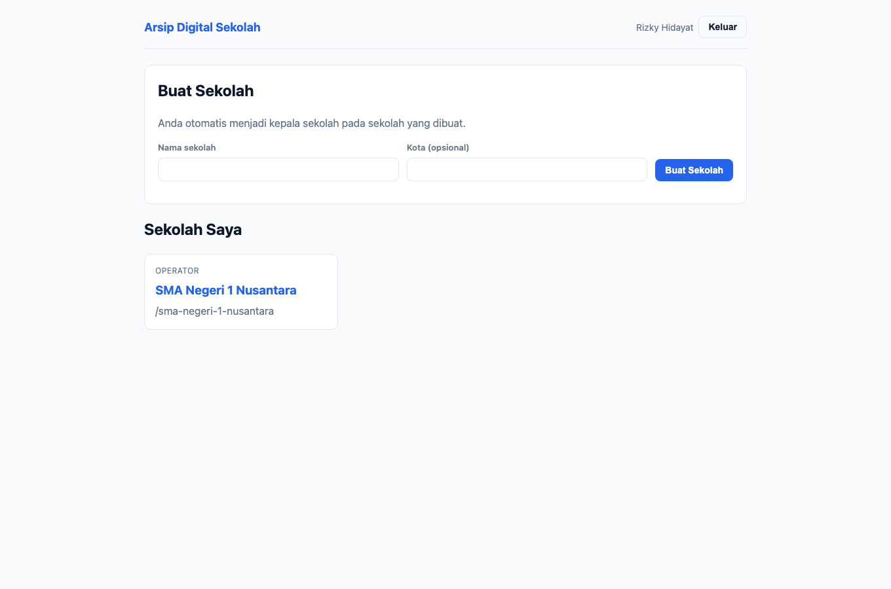
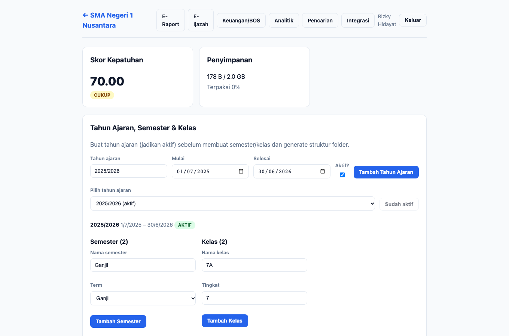
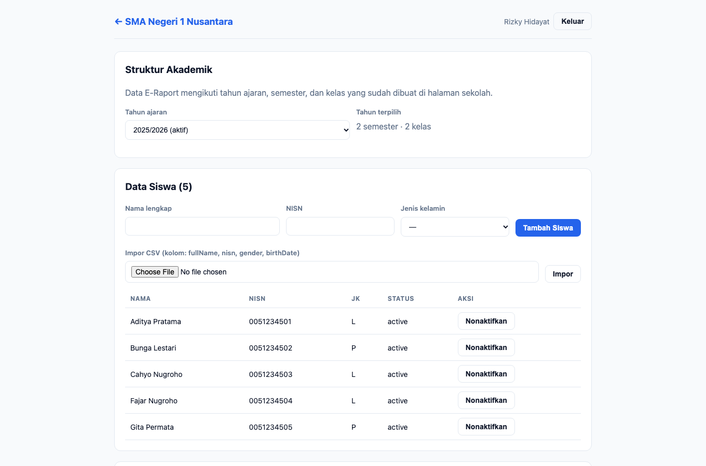
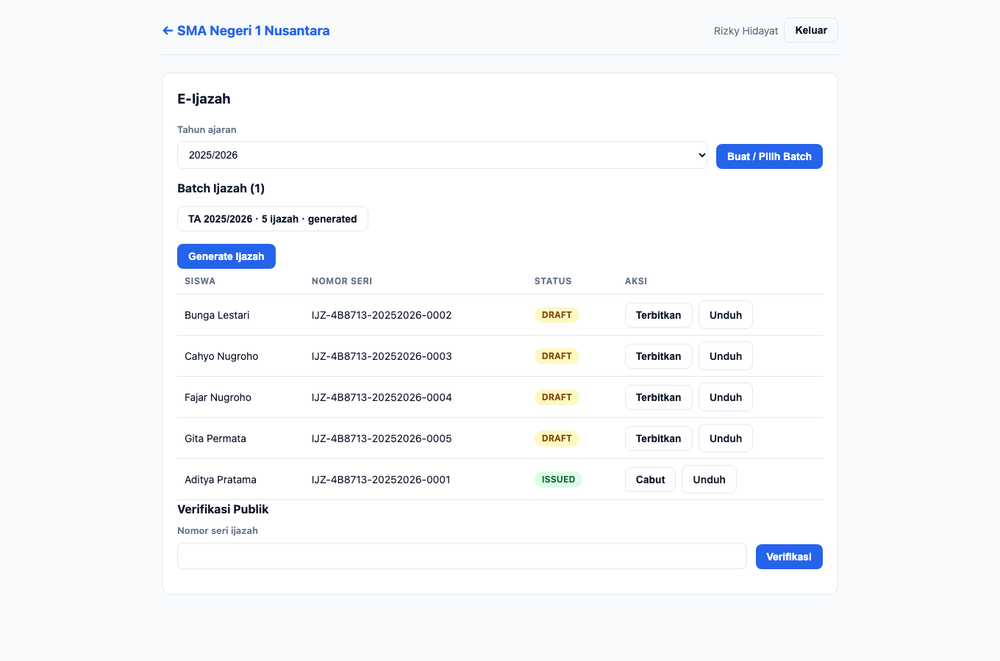

# Panduan — Operator

**Peran:** `operator`
**Inti tugas:** entri data harian — mengunggah dokumen, mengelola struktur akademik,
data siswa, entri nilai, serta membuat batch & sertifikat ijazah.

## 1. Dasbor

Operator melihat daftar sekolah tempat ia menjadi anggota. Klik kartu sekolah untuk
masuk ke ruang kerja.

## 2. Beranda sekolah

Operator melihat **Skor Kepatuhan** dan **Penyimpanan**, mengelola struktur akademik,
mengunggah dokumen, melihat daftar dokumen & versioning, serta aturan retensi.
Panel **Jejak Audit** tidak ditampilkan (kewenangan pengelola/auditor).

### 2.1 Struktur akademik & folder

- Panel **Tahun Ajaran, Semester & Kelas**: operator dapat membuat/mengubah tahun
  ajaran, semester, dan kelas. **Mengaktifkan** tahun ajaran hanya untuk kepala
  sekolah/kepala TU.
- **Generate struktur folder** otomatis hanya untuk kepala sekolah/kepala TU.
  Operator dapat membuat folder manual di dalam struktur yang ada.

### 2.2 Unggah dokumen

1. Pilih **Jenis dokumen**, isi **Judul**/catatan perubahan (opsional).
2. Pilih **Berkas**, lalu klik **Unggah**. Berkas identik otomatis dideduplikasi.

### 2.3 Daftar dokumen

Lihat status, retensi, ukuran, dan status legal hold dokumen. Operator **tidak**
dapat menetapkan/melepas legal hold (kewenangan kepala sekolah/TU/auditor).

## 3. E-Raport

Operator mengelola seluruh data induk akademik:

1. **Data Siswa** — tambah siswa satu per satu atau **impor CSV**; hapus
   (soft delete: status `inactive`, nilai & raport tetap utuh).
2. **Mata Pelajaran** — tambah mapel (nama + kode).
3. **Penugasan Siswa ke Kelas** — pilih kelas, centang siswa, klik **Tugaskan**.
4. **Entri Nilai** — pilih kelas & mapel, isi nilai, **Simpan Nilai**.
5. **Raport** — pilih kelas & semester, **Generate Raport**, lalu **Unduh** PDF.

Lihat langkah rinci entri nilai di
[Panduan Guru → E-Raport](guru.md#4-e-raport).

## 4. E-Ijazah

1. Pilih **Tahun Ajaran**, lalu **Buat Batch**.
2. Klik **Generate** untuk membuat sertifikat (`draft`) bagi siswa terdaftar.
3. Operator **dapat** membuat batch & generate sertifikat, tetapi **tidak dapat
   menerbitkan/mencabut** — tindakan tersebut hanya untuk kepala sekolah/kepala TU.
4. **Unduh PDF** ijazah ber-QR (untuk ijazah yang sudah terbit).

## 5. Keuangan/BOS

Operator dapat **mencatat** arsip keuangan (kategori + nominal + dokumen tertaut) dan
melihat ringkasan. **Ekspor paket audit** hanya untuk kepala sekolah/TU/auditor.

## 6. Pencarian & OCR

Menu **Pencarian** untuk mencari arsip ber-facet. Operator juga dapat **menjalankan
OCR tertunda** untuk memproses berkas yang belum terindeks.

## 7. Yang tidak dapat dilakukan operator

- Menetapkan **legal hold** dan melihat **jejak audit**.
- **Generate struktur folder** dan mengaktifkan tahun ajaran.
- **Menerbitkan/mencabut ijazah** dan **mengekspor paket audit** keuangan.
- Mengelola **integrasi/backup** dan melihat **analitik** (sekolah & jaringan).

---

## Catatan teknis (untuk pemelihara)

- Sumber skenario: `apps/e2e/tests/docs/panduan.spec.ts` (test *operator*).
- Generator menegaskan operator **melihat** `compliance-score` namun **tidak**
  melihat `audit-log-list`, dan halaman tanpa `page-error`.
